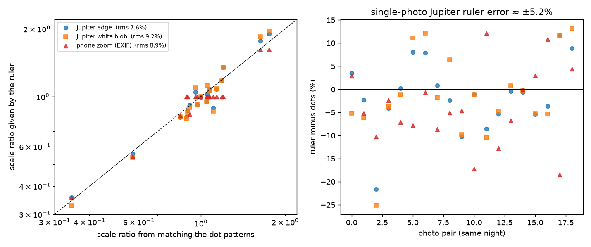
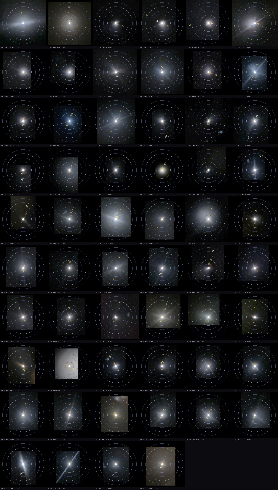
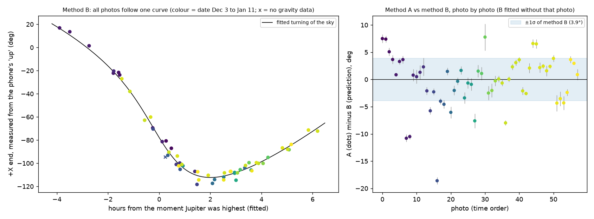
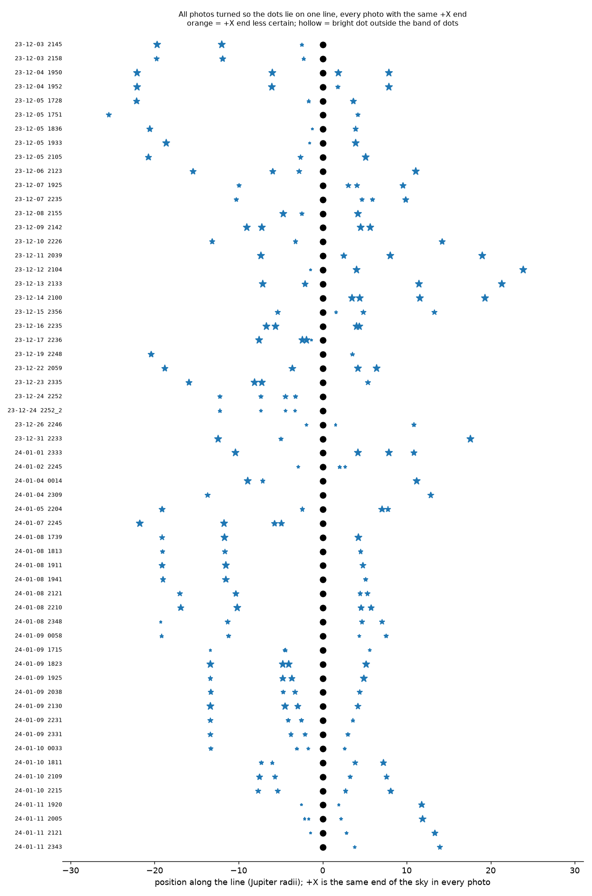
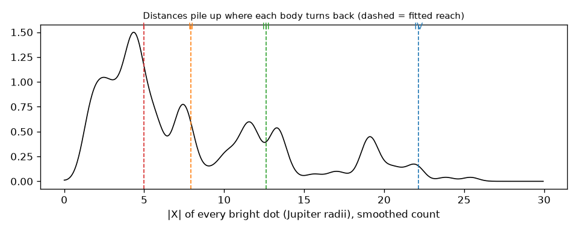
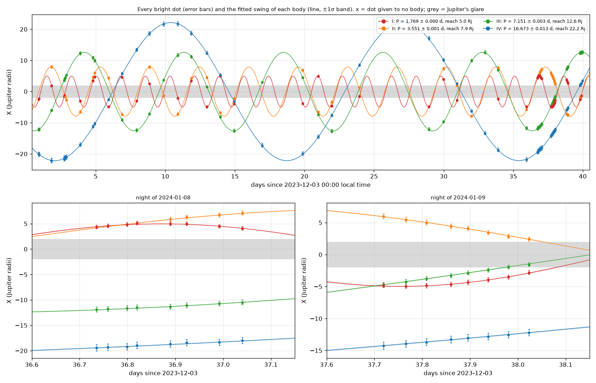
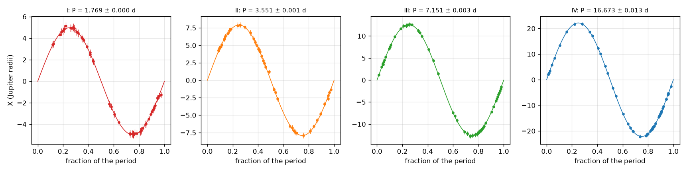

# jupiter-study: what if I were Galileo?

**English** · [中文](README.zh-CN.md)

All I have are 58 phone photos of Jupiter taken through a telescope eyepiece
(2023-12-03 to 2024-01-11, Riverside, California). Pretend I am the first
person to look at Jupiter through a telescope, in 1610: no NASA data, no idea
that the dots next to Jupiter are moons, no idea that they move back and forth
periodically. Work everything out from the photos, one step at a time.

**Allowed**: the photos; what the camera wrote into them (time, zoom, iPhone
gravity sensor); the observing site given by the photographer
(`data/observer.json`: 33.976683° N, 117.310320° W, known to within 30 m).
**Not used**: any ephemeris, orbit, moon name, size of or distance to Jupiter.

Every result carries two separate error bars: the **photo error** (from
measuring pixels) and the **site error** (from not knowing the camera position
better than 30 m).

## Progress

| Step | What | Status |
|---|---|---|
| 1 | Put every photo on the same scale | ✅ |
| 2 | Same orientation: line horizontal, same end on the same side in all photos | ✅ |
| 3 | Which dots are the same body, how they swing, how long they take | ✅ |
| — | Interactive demo page (`demo/`) | ✅ |

**Main result**: four bodies swing back and forth next to Jupiter, with periods

| Body | Period (days) | Photo error | Site error | Reach (Rj) |
|---|---|---|---|---|
| I | 1.7687 | ± 0.0005 | ± 2e-12 | 4.96 ± 0.07 |
| II | 3.5513 | ± 0.0012 | ± 3e-11 | 7.92 ± 0.11 |
| III | 7.1511 | ± 0.0032 | ± 1e-10 | 12.61 ± 0.16 |
| IV | 16.673 | ± 0.013 | ± 5e-10 | 22.15 ± 0.27 |

## Checking the dots

The detector (`scripts/detect.py`) finds 848 candidate bright points in the 58
photos, most of them glare ripples, noise or ground lights. Which bright points
are the dots of the small bodies next to Jupiter was confirmed photo by photo
and recorded in `data/visual_check.json` (pixel coordinates only): 205 dots,
5 of them missed by the detector but visible in the photo (mostly right at
Jupiter's edge, or crowded next to a shake double), centred from the photo's
pixels. Steps 1–3 use only these 205 confirmed dots.

## Step 1: same scale

**Problem**: every photo has a different magnification. Jupiter is 20 px in
radius in one photo and 130 px in another.

**The ruler is Jupiter itself** (Galileo also measured in Jupiter diameters).
Every distance is in Jupiter radii (Rj). Jupiter and the dots are in the same
photo, so whatever changes the magnification changes both together. Jupiter is
overexposed and the white blob grows with exposure, so its edge is the radius
where the ring-averaged brightness falls fastest.

**Checking the ruler with no outside data**: photos from the same night, taken
within 90 minutes, show almost the same pattern of dots. Lining up the two
patterns gives the true scale ratio of the two photos. Over 19 such pairs:

| Ruler | Difference from the dot patterns (rms) |
|---|---|
| Jupiter edge (steepest drop, used) | **7.6%** |
| Phone zoom (EXIF) | 8.9% |
| Jupiter white blob | 9.2% |



**Findings**:
- The phone zoom is not reliable: on Jan 9 the zoom stayed at 5x all night,
  yet the real scale changed by about ±10% between neighbouring photos.
- The Jupiter edge alone is good to about ±5.2% per photo; the 27 photos linked
  through their dots on the same night are averaged, bringing them to 2.2–5.2%.
- Step 3 measures the real single-photo scale error the other way round (each
  body always swings to the same distance): about ±5.9%, in line with this.
  The Dec 17 photo (the only one from an iPhone 14 Pro) was off the most: a
  bigger glare made Jupiter about 40% too big; step 3 corrects it.
- Site error: the scale is (dot offset angle) / (Jupiter radius angle), both
  seen from the same spot at the same moment; moving the camera 30 m changes
  the ratio by less than 5e-10.

**Not known**: because Jupiter is overexposed, the steepest-drop edge may be
larger than the real edge by one fixed factor, the same for all photos. It
does not affect comparing photos or the periods, but it cannot be pinned down
without outside data.



## Step 2: same orientation

**Problem**: the phone was turned differently for each photo, and the sky
itself turns during the night (Jupiter rises and sets, the sky turns relative
to the horizon), so the line of dots points a different way in every photo.
The line also has two ends, which must be matched up.

**Galileo's first finding: the dots always lie on one straight line.** Three
independent methods find it and are compared:

| Method | How | Strength | Limit |
|---|---|---|---|
| A Dots | in each photo, the line through Jupiter closest to the dots | precise angle (median ±0.8°) | cannot tell the two ends apart |
| B Gravity + turning sky | the iPhone recorded which way was down; measured from there, the line turns the same way every night, so one fitted curve predicts its direction in every photo, **including which end is which** | puts every photo on the same end | ±3.9° per photo |
| C Same-night pairs | photos up to 3 h apart matched through their dot patterns | direct, reliable | used to check B |



**What B found**: the phone stayed almost upright (within about 10°), yet the
line turns by over 100° in a night, and every night of December and January
falls on the same curve. Fitting it gives, from the photos alone:

- Jupiter was highest at **21:20 ± 2 min** on Dec 3, declination **+13.8° ± 0.7°**, and came back 0.56 ± 0.11 min per day earlier than the stars (its own motion among them)
- the sense of the turning says the view is **not mirrored**; with the altitude term, it looks like a reflector with the eyepiece sticking out sideways
- the Jan 10 photo named 18:11 has camera time 20:11. With the camera time the prediction is 4° off; with the file-name time, 55°. **The camera time is right**

**Cross-checks**: A vs B rms 4.8°, none beyond 3 sigma; C checks B: **36/36**
pairs agree; every photo's +X end is known with a margin of at least 4 sigma;
the gravity axes are checked too (flipping them makes the fit clearly worse).

**Final direction**: the most likely angle given A's dots and B's prediction;
a far dot fixes the angle much better than a near one, so dots are weighted by
distance. B picks the +X end. Median error ±0.8°.

**A band, not a line**: once turned, every confirmed dot lies within ±2.6 Rj of
the line (rms 0.43 Rj), and the outer bodies stray farther (step 3): the orbits
are not seen exactly edge-on.

**Which end is +X**: +X is the same end of the sky in every photo. Whether it
is east or west depends on whether the telescope shows the sky upright or
upside down, which the photos do not show.

| Source | Size | Why |
|---|---|---|
| Photo `err_photo_deg` | median ±0.8° | angle from A and B combined |
| Site `err_site_deg` | at most 5e-6° | B uses the latitude; refitting with it moved by 30 m changes the predicted angle by at most 0.0002°, the declination by 0.0004°, the transit time by 0.0001 min |



## Step 3: how they move

**Counting bodies**: something swinging back and forth spends most of its time
near its farthest point, so distances pile up. They pile up near 4.4, 7.5,
11.6 and 19.1 Rj: **four bodies**.



**Outside in, one at a time**: only the outermost body reaches the outermost
pile-up, so look for it first. Try every period from 0.5 to 50 days, every
start and reach; score photo by photo: +1 if a dot sits where the guess puts
the body, −1 if the guess puts it in plain view (inside the photo, outside
Jupiter's glare) and nothing is there. "Should be there but isn't" is evidence
too. Take the best, hand it its dots, go one body in. A body counts only if its
best score is clearly above what a period picked at random reaches (99th
percentile of all periods tried, plus 3).

**All four together**: each dot goes to the body predicted nearest to it,
then every swing X = A sin(2π t / P + φ) is fitted together with one scale
correction per photo (first searched from 0.5 to 1.6 for the one that lines
the dots up best with the predictions). **All** 205 dots go to a body; the
median residual is 0.08 Rj.





**Checks**:
- **Aliases**: most photos were taken at about the same hour, so P and "one
  turn more or less per day" look alike. Each body lists its closest rival
  periods (`bodies.json`); e.g. I at 1.769 d scores 45, its rival 2.301 d only
  23.5. The nights with many photos (Jan 8 and 9) tell them apart.
- **Circles, not lines**: as they swing, the dots also drift across the line in
  step with cos(phase) (I −0.26 ± 0.04, II −0.38 ± 0.03, III −0.54 ± 0.05,
  IV −0.66 ± 0.07 Rj), in proportion to their reach: they go round circles seen
  slightly from the side, all four the same way round.

**Errors**:
- Photo: the larger of the fit covariance (scaled by the actual scatter) and a
  bootstrap over nights (200 refits, each on 31 nights drawn at random).
- Site: step 2's site error turns each photo by a tiny angle, which moves X by
  Y × angle. That change is far below the fit's numerical precision, so it is
  applied 10,000 times larger and the result scaled back.

## Demo page

`demo/` is an interactive page: the original and the marked-up version of
every photo, the three rulers, the turning-sky curve, the motion with error
bars and bands, and the period table. To view it locally:

```bash
python3 -m http.server -d demo 8000
```

then open http://localhost:8000/view.html . `demo/data.json` and the images
are made by `scripts/make_demo.py`.

## Layout

```
data/raw/                 the 58 original photos (file name = local time)
data/observer.json        observing site
data/visual_check.json    dots confirmed photo by photo (pixel coordinates)
scripts/common.py         photo list, EXIF, gravity sensor, decoding
scripts/detect.py         find Jupiter and candidate dots
scripts/step1_scale.py    step 1
scripts/step2_orient.py   step 2
scripts/field_rotation.py step 2 method B: the turning-sky model
scripts/step3_motion.py   step 3
scripts/make_demo.py      data and images for the demo page
output/step1/             scale.csv, pairs.csv, detections.json, ruler_check.png, same_scale.jpg
output/step2/             orientation.csv, positions.csv, links.csv, summary.json, field_rotation.png, notebook.png, strips.jpg
output/step3/             bodies.json, assignments.csv, photo_scale.csv, summary.json, motion.png, folded.png, piles.png
demo/                     demo page (index.html for claude.ai, view.html for a local server)
```

## Run

```bash
python3 -m venv .venv
.venv/bin/pip install -r requirements.txt
for s in step1_scale step2_orient step3_motion make_demo; do .venv/bin/python scripts/$s.py; done
```

About 12 minutes in all (Raspberry Pi 5). The first run decodes the photos into
`cache/` (about 650 MB, not in git).

The previous version (analysis using NASA ephemerides) is in the git history
(commit `4d0c22b`).
