# jupiter-study: what if I were Galileo?

**English** · [中文](README.zh-CN.md)

All I have are 58 phone photos of Jupiter taken through a telescope eyepiece
(2023-12-03 to 2024-01-11, Riverside, California). Pretend I am the first
person to look at Jupiter through a telescope, in 1610: no NASA data, no idea
that the dots next to Jupiter are moons, no idea that they move back and forth
periodically. Work everything out from the photos, one step at a time.

**Allowed**: the photos; what the camera wrote into them (time, zoom, iPhone
gravity sensor); the observing site given by the photographer
(`data/observer.json`: 33.976683° N, 117.310320° W, known to within 30 m).
**Not used**: any ephemeris, orbit, moon name, size of or distance to Jupiter. The one exception is the last section, which checks the accuracy against NASA's ephemeris.

Every result carries its **photo error** (from measuring pixels). The **site
error** (from not knowing the camera position better than 30 m) was worked out
at every step and is negligible (for the periods, less than a millionth of the
photo error), so it is no longer listed.

## Demo

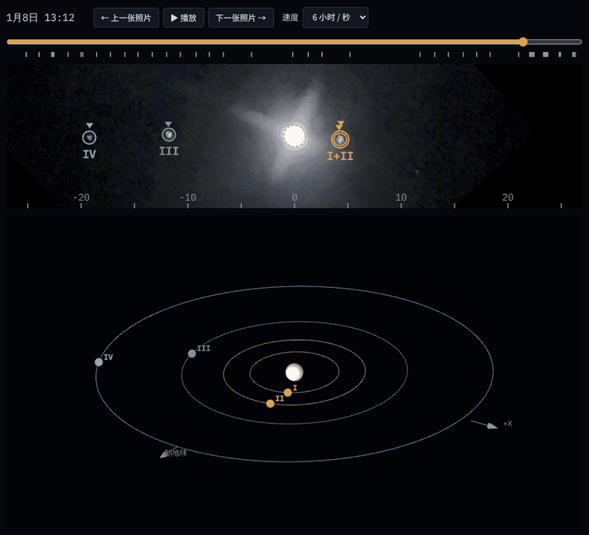

The demo page walks through how the photos lead to these results: every photo, Jupiter as the ruler, the evidence for going around, turning the photos, the four periods (parts 1–8), the model, and finally the comparison with NASA and a summary.

- **One file, double-click to open**: [`demo/jupiter-demo.html`](demo/jupiter-demo.html) (about 6 MB; page, data and pictures all inside).
  Open it on GitHub, press "Download raw file" at the top right, then open it in a browser. The 3D model loads three.js from the internet; the rest works offline.
- **Local server**: `python3 -m http.server -d demo 8000`, then open http://localhost:8000/view.html.

<details><summary>More screenshots</summary>

Every photo: as taken, with the confirmed dots

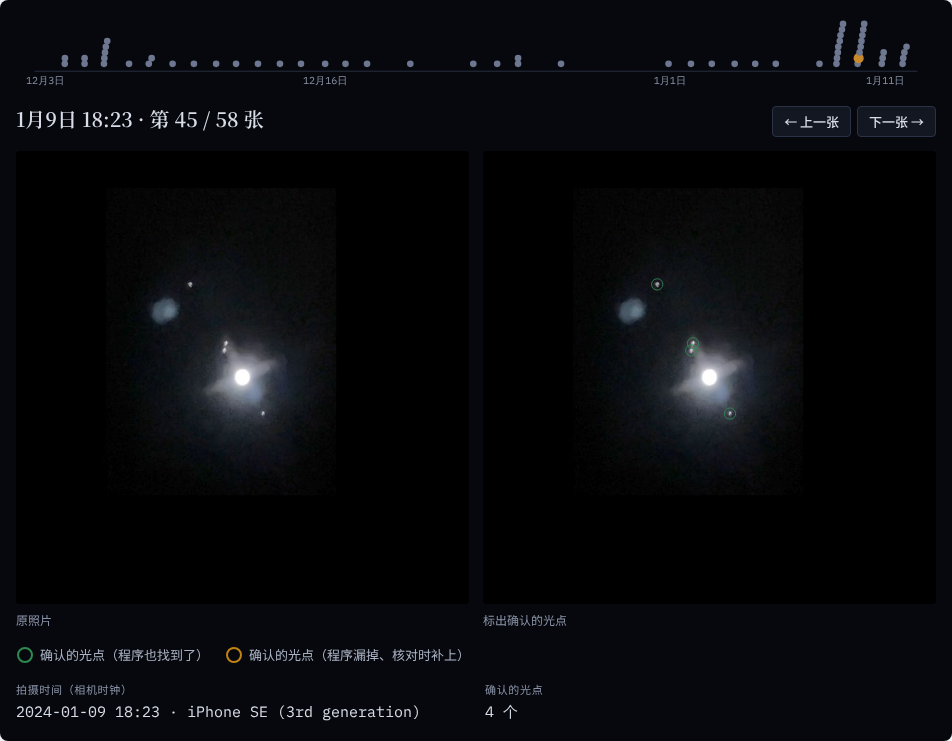

Step 4, part 5: all four together, which dot belongs to which body

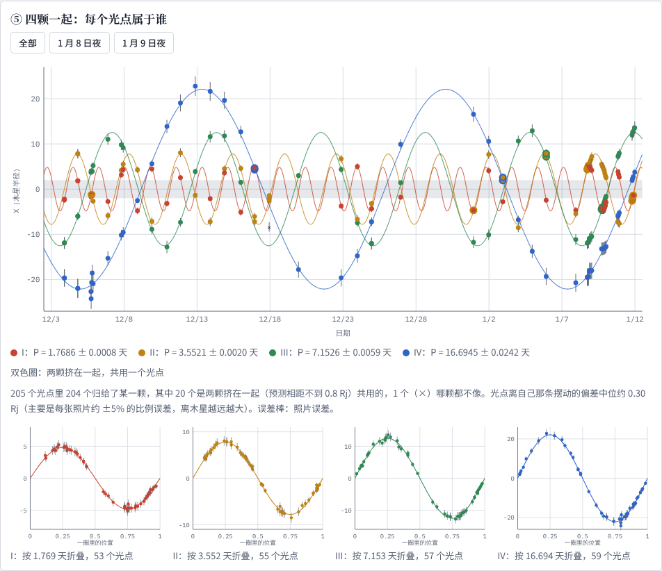

Last: every dot against NASA's positions

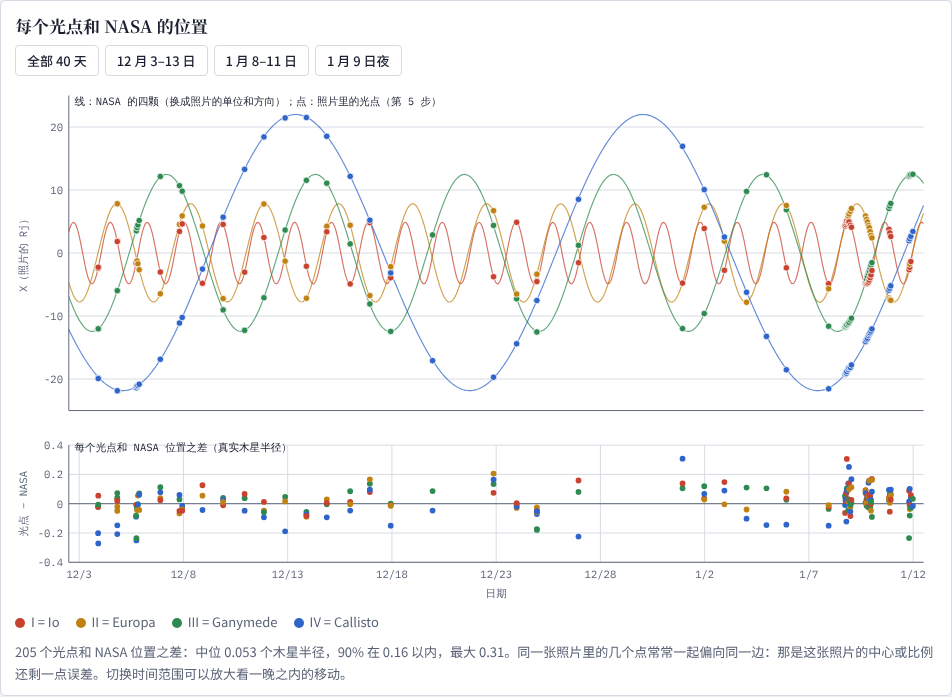

Summary

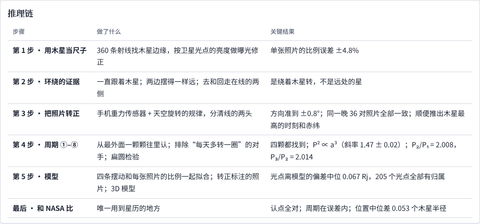

</details>

## Progress

Steps follow the demo page; the script numbers are older and do not quite match.

| Page | What | Scripts | Status |
|---|---|---|---|
| Step 1 | Jupiter as the ruler: every photo on the same scale | `step1_scale.py` | ✅ |
| Step 2 | Are they going around Jupiter? The evidence | computed on the page | ✅ |
| Step 3 | Turn every photo: line horizontal, the same end of the sky to the right | `step2_orient.py`, `field_rotation.py` | ✅ |
| Step 4 | How long each of the four takes to go round (redone from scratch, parts 1–8) | `step4_*.py` | ✅ |
| Step 5 | The model: every photo's own scale, turned and labelled photos, a 3D model | `step5_model.py` | ✅ |
| Last | Accuracy against NASA's ephemeris (the only place it is used) | `check_nasa.py` | ✅ |
| Comparison | The earlier identification and periods | `step3_motion.py` | kept |

**Main result** (step 5, from the photos alone): four bodies go around Jupiter on circles seen almost edge-on, all in one plane and all the same way round.

| Body | Period (days) | Reach (Rj) | Tilt (°) | Dots |
|---|---|---|---|---|
| I | 1.76895 ± 0.00020 | 4.91 ± 0.05 | -3.0 ± 0.4 | 49 |
| II | 3.55108 ± 0.00070 | 7.83 ± 0.09 | -3.0 ± 0.2 | 48 |
| III | 7.15117 ± 0.00179 | 12.47 ± 0.12 | -2.5 ± 0.2 | 56 |
| IV | 16.6730 ± 0.0058 | 21.92 ± 0.22 | -1.7 ± 0.2 | 58 |

± is the photo error. Reach is in step 1's "Jupiter radius" (the overexposed disk measures too large by an uncalibrated factor). Tilt is how far each orbit is from exactly edge-on.
Period and reach follow P² ∝ a³ (Kepler's third law), and the inner three periods are locked at 1 : 2 : 4 (step 4, part 8).

## Checking the dots

The detector (`scripts/detect.py`) finds 848 candidate bright points in the 58
photos, most of them glare ripples, noise or ground lights. Which bright points
are the dots of the small bodies next to Jupiter was confirmed photo by photo
and recorded in `data/visual_check.json` (pixel coordinates only): 205 dots,
5 of them missed by the detector but visible in the photo (mostly right at
Jupiter's edge, or crowded next to a shake double), centred from the photo's
pixels. Steps 1–3 use only these 205 confirmed dots.

## Step 1: same scale

**Problem**: every photo has a different magnification. Jupiter is 20 px in
radius in one photo and 130 px in another.

**The ruler is Jupiter itself** (Galileo also measured in Jupiter diameters).
Every distance is in Jupiter radii (Rj). Jupiter and the dots are in the same
photo, so whatever changes the magnification changes both together. Jupiter is
overexposed and the white blob grows with exposure, so its edge is where the
brightness falls fastest: 360 rays go out from Jupiter's centre, each gives one
edge point, and a circle is fitted to the 360 points (single rays pulled out by
a diffraction spike or a flare count for little). The circle's centre is
Jupiter's centre; the spread of the points gives each photo's measuring error
(median ±0.4%).

**Exposure fix**: a harder exposure spreads the overexposed white further, so
even the steepest drop moves out. How hard a photo was exposed shows in the
same photo: the dots' total light (gamma undone, background removed) divided by
Jupiter's area in the photo is proportional to how bright each pixel of
Jupiter's disk is, and a shake that smears a dot does not change its total
light. The same-night dot patterns show that the edge grows by **6.3% ± 3.0%**
each time this brightness grows e-fold (about 2.7x). Every edge is brought back
to the median exposure with that rule.

**Checking the ruler with no outside data**: photos from the same night, taken
within 90 minutes, show almost the same pattern of dots. Lining up the two
patterns gives the true scale ratio of the two photos. Over 19 such pairs:

| Ruler | Difference from the dot patterns (rms) |
|---|---|
| Jupiter edge + exposure fix (used) | **7.0%** |
| Jupiter edge (circle through 360 rays) | 8.0% |
| Phone zoom (EXIF) | 8.9% |
| Jupiter white blob | 12.5% |

(The earlier edge, the steepest drop of ring-averaged brightness, scored 9.0%
on the same test.)

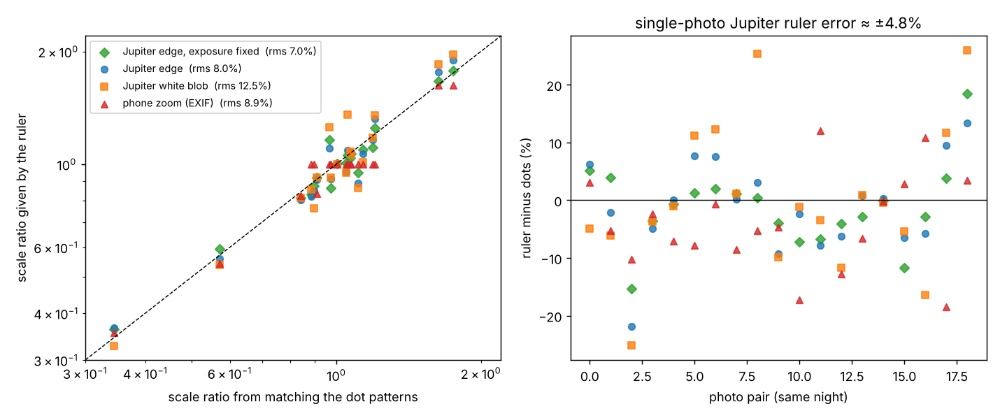

**Findings**:
- The phone zoom is not reliable: on Jan 9 the zoom stayed at 5x all night,
  yet the real scale changed by about ±10% between neighbouring photos.
- The Jupiter edge with the exposure fix is good to about ±4.8% per photo
  (before: ±6.2%); the 27 photos linked through their dots on the same night
  are averaged, bringing them to 2.1–3.7%.
- Step 5 measures the real single-photo scale error the other way round (each
  body always swings to the same distance): typically ±4.5%, in line with
  this. The Dec 17 photo (the only one from an iPhone 14 Pro) was off the most:
  a bigger glare made Jupiter about 49% too big; step 5 corrects it (× 0.672).
  The Dec 26 photo had the shortest exposure, the least overexposure, and the
  smallest-looking Jupiter.
- Tried and not used: measuring only at right angles to the shake (matched the
  dot patterns worse), and re-centring the dots at full resolution (no gain).
- Compared with before, the common "1 Rj" is about 3% bigger in pixels (the ray
  edge sits slightly farther out), so every distance in Rj is about 3% smaller.
  This is a choice of unit and does not touch the periods.
- Site error: the scale is (dot offset angle) / (Jupiter radius angle), both
  seen from the same spot at the same moment; moving the camera 30 m changes
  the ratio by less than 5e-10.

**Not known**: the exposure fix brings every photo to the same exposure, but at
that exposure the steepest-drop edge may still be larger than the real edge by
one fixed factor, the same for all photos. It
does not affect comparing photos or the periods, but it cannot be pinned down
without outside data.

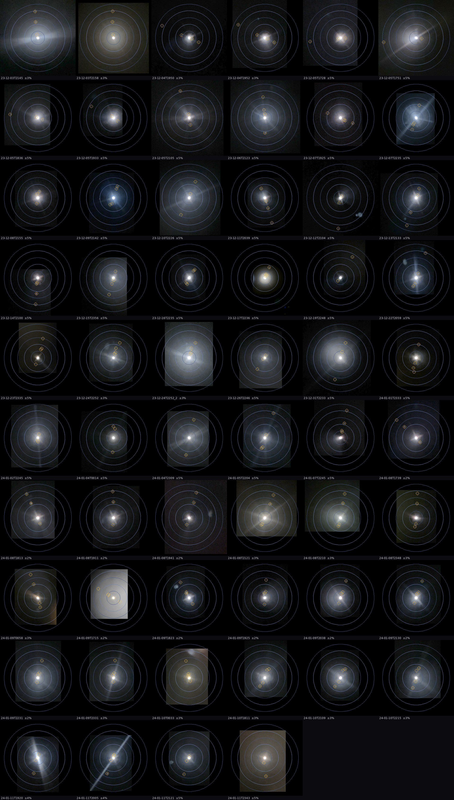

## Step 2: are they going around Jupiter? (computed on the page)

Once the photos are turned and on one scale, what are the dots: distant stars,
or something swinging along a line? Three pieces of evidence from the photos
alone, before any period is known: (1) over 40 days they stay with Jupiter
(Jupiter itself moves about 3° against the stars, far more than the telescope's
field); (2) along the line the dots pile up symmetrically near the far ends,
so they swing out equally far both ways; (3) going out and coming back they
keep to opposite sides of the line (from same-night photos only, a first hint;
the full test is step 4, part 7).

## Step 3: same orientation (`step2_orient.py`)

**Problem**: the phone was turned differently for each photo, and the sky
itself turns during the night (Jupiter rises and sets, the sky turns relative
to the horizon), so the line of dots points a different way in every photo.
The line also has two ends, which must be matched up.

**Galileo's first finding: the dots always lie on one straight line.** Three
independent methods find it and are compared:

| Method | How | Strength | Limit |
|---|---|---|---|
| A Dots | in each photo, the line through Jupiter closest to the dots | precise angle (median ±0.8°) | cannot tell the two ends apart |
| B Gravity + turning sky | the iPhone recorded which way was down; measured from there, the line turns the same way every night, so one fitted curve predicts its direction in every photo, **including which end is which** | puts every photo on the same end | ±3.9° per photo |
| C Same-night pairs | photos up to 3 h apart matched through their dot patterns | direct, reliable | used to check B |

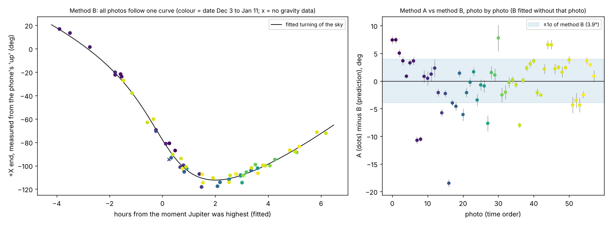

**What B found**: the phone stayed almost upright (within about 10°), yet the
line turns by over 100° in a night, and every night of December and January
falls on the same curve. Fitting it gives, from the photos alone:

- Jupiter was highest at **21:20 ± 2 min** on Dec 3, declination **+13.8° ± 0.7°**, and came back 0.56 ± 0.11 min per day earlier than the stars (its own motion among them)
- the sense of the turning says the view is **not mirrored**; with the altitude term, it looks like a reflector with the eyepiece sticking out sideways
- the Jan 10 photo named 18:11 has camera time 20:11. With the camera time the prediction is 4° off; with the file-name time, 55°. **The camera time is right**

**Cross-checks**: A vs B rms 4.8°, none beyond 3 sigma; C checks B: **36/36**
pairs agree; every photo's +X end is known with a margin of at least 4 sigma;
the gravity axes are checked too (flipping them makes the fit clearly worse).

**Final direction**: the most likely angle given A's dots and B's prediction;
a far dot fixes the angle much better than a near one, so dots are weighted by
distance. B picks the +X end. Median error ±0.8°.

**A band, not a line**: once turned, every confirmed dot lies within ±2.3 Rj of
the line (rms 0.42 Rj), and the outer bodies stray farther (step 4, part 7): the
orbits are not seen exactly edge-on.

**Which end is +X**: +X is the same end of the sky in every photo. Whether it
is east or west depends on whether the telescope shows the sky upright or
upside down, which the photos do not show.

| Source | Size | Why |
|---|---|---|
| Photo `err_photo_deg` | median ±0.8° | angle from A and B combined |
| Site `err_site_deg` | at most 5e-6° | B uses the latitude; refitting with it moved by 30 m changes the predicted angle by at most 0.0002°, the declination by 0.0004°, the transit time by 0.0001 min |

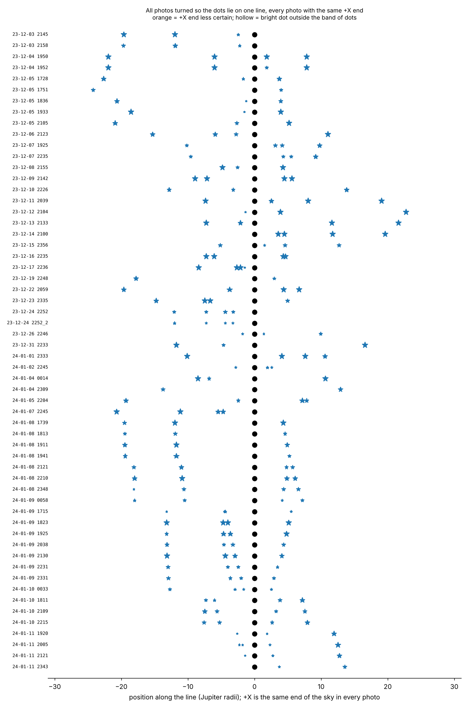

## Step 4: periods (redone from scratch, `step4_*.py`)

No number of bodies assumed and no curves drawn: it starts from the raw "time, position" of every dot.

| Part | What | Script |
|---|---|---|
| 1 | 205 dots: only the time and the position X along the line | `step4_raw_plot.py` |
| 2 | Nights with several photos: link the dots into tracks (along the line by extrapolation, across it by keeping Y) | `step4_tracks.py` |
| 3 | The outermost body: beyond 16 Rj only one body reaches; fold for its period (dots + one-night speeds + "should be there but isn't") | `step4_fold.py` |
| 4 | Take away the explained dots, fold beyond the next gap; the inner two overlap and are found as a pair | `step4_peel.py`, `step4_inner.py` |
| 5–8 | All four together; the "one turn more per day" rivals; the tilt check; how the periods relate | `step4_joint.py` |

Results (photo errors; no per-photo scale correction yet at this step):

| Body | Period (days) | Reach (Rj) | Drift across the line B (Rj) |
|---|---|---|---|
| I | 1.7686 ± 0.0008 | 4.81 ± 0.08 | -0.25 ± 0.04 |
| II | 3.5521 ± 0.0020 | 7.78 ± 0.13 | -0.32 ± 0.05 |
| III | 7.1526 ± 0.0059 | 12.52 ± 0.20 | -0.57 ± 0.06 |
| IV | 16.6945 ± 0.0242 | 22.10 ± 0.35 | -0.60 ± 0.08 |

- Part 4 counts a gap in |X| only when enough dots (≥ 8) lie beyond it to fold. For the inner pair, folding alone
  favours a wrong period; finding the two together and asking that neither predicts a body where there is no dot
  singles out 3.53 + 1.77 d.
- Part 6: the "one turn more or less per day" rivals score at least 35 times worse; at least 9 times without the nights with several photos.
- Part 7: the drift across the line B is negative for all four (6–10 times its error): circles seen almost edge-on, in one plane, turning the same way.
- Part 8: slope of log P against log a **1.47 ± 0.02** (Kepler's third law: 1.5); P₂/P₁ = 2.0084, P₃/P₂ = 2.0136;
  1/P₁ − 3/P₂ + 2/P₃ = (0.45 ± 0.59)×10⁻³ turns per day, consistent with 0.

## Step 5: the model (`step5_model.py`)

Step 4's four swings and every photo's own scale are fitted together: a body always swings out to the same distance, so a photo with dots of two or more bodies tells its own scale.
The dots are also handed out again: for every photo each stretch from 0.6 to 1.6 is tried, and the dots go to the bodies one to one (at most one dot per body; two bodies predicted close together may share one).

- All 58 photos get their own scale, typically ±4.5%; the largest is the Dec 17 photo (× 0.672).
- All 205 dots belong to a body; the median distance from the model is **0.067 Rj** (step 4, part 5: 0.30 Rj); the period errors shrink about 3.6-fold.
- Tilt (drift across the line ÷ reach): -3.0°, -3.0°, -2.5°, -1.7°, all negative.
- Output: every photo turned and put on the common scale (`demo/final/`; the page draws the labels on top), all photos labelled in `output/step5/annotated.jpg`, the model in `output/step5/model.png`.

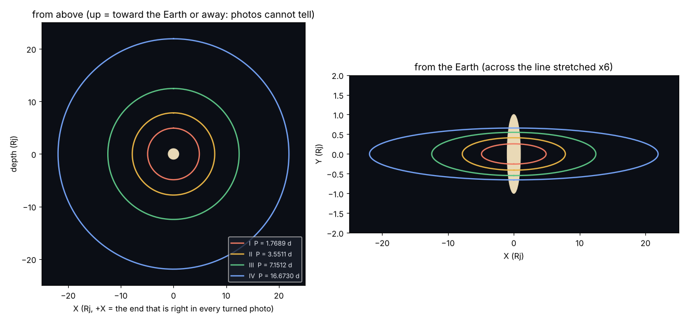

Step 5 on the page ends with an annotated note on why the periods are so much more precise than any single dot (residuals before and after the scale fix, a "change the period a little" chart for counting turns, the textbook limit side by side), and on these being periods as seen from the Earth: the ± does not include the effect of the Earth's own motion.

On the page, step 5 has a time slider (with play), the photo nearest that moment (turned, on the common scale, labelled, with the model's predictions), and a 3D model built from the photos alone
(from the Earth / from above / from the side / oblique, with the sight line of every dot in the photo). What the photos cannot tell: which half of each orbit is in front of Jupiter (the model can swap front and back and looks the same from the Earth),
whether +X is east or west, the true size and mass, and what the moons and Jupiter look like.

## Last: against NASA (`check_nasa.py`)

Steps 1–5 use no NASA numbers at all. This is the one exception: the photo-only results compared with the moons' positions
from NASA's JPL Horizons system (same observing site, each photo's camera time, light time corrected; see `data/nasa/README.md`).
The two things the photos cannot tell, how many true Jupiter radii the photos' "1 Rj" is and whether +X points east or west,
are fitted from all the dots at once.

| Item | Photos only | NASA | Verdict |
|---|---|---|---|
| Which bodies | I–IV (numbered outward) | I = Io, II = Europa, III = Ganymede, IV = Callisto | match |
| Which dot is which | 205 dots | 0 given to the wrong body; 0 moons in plain view without a dot | all right |
| Periods | see below | within 1 sigma of NASA's periods fitted the same way over the same 40 days | within errors |
| Dot positions | after step 5's scale fix | median 0.053 Jupiter radii (about 1.2"); 0.20 with step 1's scale | precise |
| Each photo's scale | step 1 about ±5%, refined in step 5 | against NASA: step 1 off by 4.5%, step 5 by 0.4% | the fix works |
| How big is "1 Rj" | overexposed, uncalibrated | the photos' 1 Rj = **1.202** true Jupiter radii (the glare makes Jupiter 20% too big); the same for all four | new |
| Mirrored image | no (step 3) | not mirrored | match |
| +X points | cannot tell | east | new |
| Which half is in front | cannot tell | the half moving toward +X is behind Jupiter (tick the front/back swap in the step 5 model) | new |
| Orbit tilt | I -3.0°, II -3.0°, III -2.5°, IV -1.7° | I -3.1°, II -3.4°, III -3.2°, IV -2.9° | outer ones too small |
| Jupiter highest, Dec 3 | 21:20.6 ± 2 min | 21:16.6 (4.0 min apart) | close |
| Jupiter's declination | +13.8° ± 0.7° | +12.5° (1.3° apart) | close |
| Jupiter's daily drift against the stars | 0.56 ± 0.11 min earlier | 0.09 min earlier (4.3 sigma) | error too small |
| Clock of the Jan 10 photo | camera 20:11 is right | rms 0.05 Rj at 20:11, 0.70 at 18:11 | match |

| Body | Photos only (d) | NASA: same 40 days, same fit | diff | NASA: true orbit | diff |
|---|---|---|---|---|---|
| I = Io | 1.76895 ± 0.00020 | 1.76907 | -0.6σ | 1.76914 | -1.0σ |
| II = Europa | 3.55108 ± 0.00070 | 3.55077 | +0.4σ | 3.55118 | -0.1σ |
| III = Ganymede | 7.15117 ± 0.00179 | 7.15153 | -0.2σ | 7.15455 | -1.9σ |
| IV = Callisto | 16.67298 ± 0.00584 | 16.67635 | -0.6σ | 16.68902 | -2.7σ |

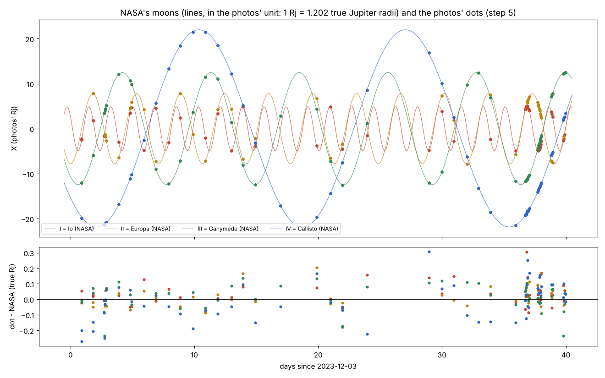

- **Periods**: the photos measure the period as seen from the Earth; it agrees with NASA's under the same conditions to about 1 sigma. Against the true orbital periods the outer ones come out short (IV by 23 minutes): the Earth itself moved during these 40 days (step 5, note 6).
- **Outer tilts too small**: each photo was turned with a line fitted to its own dots, weighted toward the far ones, which turns away part of the outermost body's drift across the line.
  Turned by step 3's method B alone (gravity sensor + turning sky, no dots): I -3.6°, II -3.7°, III -3.1°, IV -2.5°, much closer to NASA. Steps 1–5 were not changed: that change would come from having seen NASA's answer.
- **The sky's daily drift**: off by 4.3 sigma, so its error was underestimated; it does not affect the turning (36 of 36 pairs right).
- **Unit**: multiply the photos' distances by 1.20 for true Jupiter radii.
- **Borrowed numbers give the mass** (mostly borrowed, not a photo result): with NASA's unit and Jupiter's radius and Newton's G, the photos' periods and reaches give 1.904×10²⁷ kg (NASA 1.898×10²⁷).

## Comparison: the earlier identification and periods (`step3_motion.py`)

This is how it was done before step 4 was redone, kept for comparison; step 1's ruler check and the step 2 figures on the page still use its scale corrections and labels. Its results agree with step 5 within the errors.

**Counting bodies**: something swinging back and forth spends most of its time
near its farthest point, so distances pile up. They pile up near 4.4, 7.3,
12.0 and 19.5 Rj: **four bodies**.

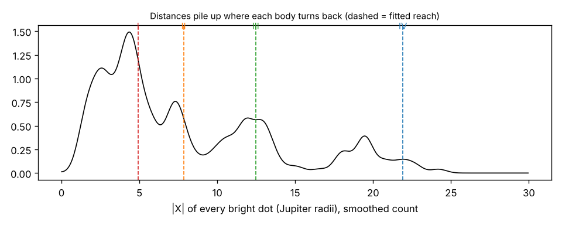

**Outside in, one at a time**: only the outermost body reaches the outermost
pile-up, so look for it first. Try every period from 0.5 to 50 days, every
start and reach; score photo by photo: +1 if a dot sits where the guess puts
the body, −1 if the guess puts it in plain view (inside the photo, outside
Jupiter's glare) and nothing is there. "Should be there but isn't" is evidence
too. Take the best, hand it its dots, go one body in. A body counts only if its
best score is clearly above what a period picked at random reaches (99th
percentile of all periods tried, plus 3).

**All four together**: each dot goes to the body predicted nearest to it,
then every swing X = A sin(2π t / P + φ) is fitted together with one scale
correction per photo (first searched from 0.5 to 1.6 for the one that lines
the dots up best with the predictions). **All** 205 dots go to a body; the
median residual is 0.05 Rj.

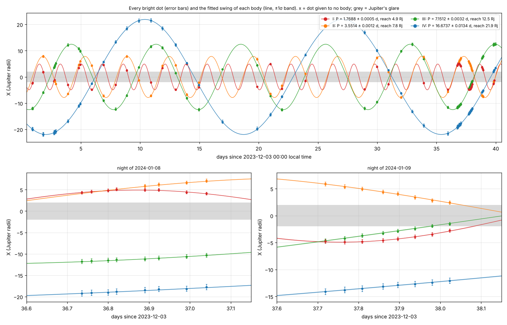

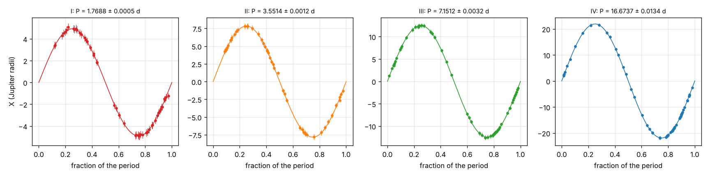

**Checks**:
- **Aliases**: most photos were taken at about the same hour, so P and "one
  turn more or less per day" look alike. Each body lists its closest rival
  periods (`bodies.json`); e.g. I at 1.769 d scores 46, its rival 2.301 d only
  24. The nights with many photos (Jan 8 and 9) tell them apart.
- **Circles, not lines**: as they swing, the dots also drift across the line in
  step with cos(phase) (I −0.25 ± 0.04, II −0.39 ± 0.03, III −0.55 ± 0.05,
  IV −0.64 ± 0.07 Rj), in proportion to their reach: they go round circles seen
  slightly from the side, all four the same way round.

**Errors**:
- Photo: the larger of the fit covariance (scaled by the actual scatter) and a
  bootstrap over nights (200 refits, each on 31 nights drawn at random).
- Site: the turning step's site error turns each photo by a tiny angle, which moves X by
  Y × angle. That change is far below the fit's numerical precision, so it is
  applied 10,000 times larger and the result scaled back.

## Demo page

`demo/` is an interactive page that follows the five steps above: every photo as taken and labelled, the rulers compared,
the evidence for going around, the turning-sky curve, step 4's parts 1–8, step 5's time slider, turned and labelled photos and 3D model, and the final comparison with NASA. To view it locally:

```bash
python3 -m http.server -d demo 8000
```

then open http://localhost:8000/view.html. The 3D model loads three.js from jsdelivr and needs the internet; the rest does not.
`demo/data.json` comes from `scripts/make_demo.py`, `demo/step4_data.json` from the step 4 scripts, `demo/model_data.json` and `demo/final/` from `scripts/step5_model.py`, `demo/nasa_data.json` from `scripts/check_nasa.py`.
The one-file version `demo/jupiter-demo.html` is packed by `python3 tools/bundle_preview.py demo demo/jupiter-demo.html` (page, data and pictures in one file that opens with a double-click); pack it again after changing the page.

## Layout

```
data/raw/                 58 original photos (file name = local time)
data/observer.json        observing site
data/visual_check.json    dots confirmed photo by photo (pixel coordinates)
data/nasa/                NASA JPL Horizons moon positions (used only for the final check)
scripts/common.py         reading photos, EXIF, gravity sensor, decoding
scripts/detect.py         Jupiter (circle through 360 rays), candidate dots, dot brightness
scripts/step1_scale.py    step 1: same scale (with the exposure fix)
scripts/step2_orient.py   step 3: same orientation
scripts/field_rotation.py step 3, method B: the turning-sky model
scripts/step3_motion.py   comparison: the earlier identification and periods
scripts/step4_*.py        step 4, parts 1-8: raw_plot, tracks, fold, peel, inner, joint
scripts/step5_model.py    step 5: final fit, turned and labelled photos, model figure
scripts/check_nasa.py     last: against NASA (the only script that reads an ephemeris)
scripts/make_demo.py      data and pictures for the demo page
output/step1/ ... step5/  results of every step (csv, json, figures)
output/check/             the comparison with NASA (nasa.json, nasa.png)
demo/                     demo page (index.html for claude.ai, view.html for a local server, jupiter-demo.html packed into one file)
docs/img/                 the animation and screenshots in this README
tests/                    Python tests; tests/page/ tests the page script (Node)
tools/bundle_preview.py   packs the page into one file
```

## Run

```bash
python3 -m venv .venv
.venv/bin/pip install -r requirements.txt
for s in step1_scale step2_orient step3_motion step4_raw_plot step4_tracks step4_fold step4_peel step4_inner step4_joint step5_model check_nasa make_demo; do .venv/bin/python scripts/$s.py; done
```

About 10 minutes in all (a cloud machine; longer on a Raspberry Pi 5). The first run decodes the photos into `cache/` (about 650 MB, not in git). Tests:

```bash
.venv/bin/python -m pytest -q tests
for t in run click tracks fold step4 joint model nasa; do node tests/page/$t.js demo; done
```

The previous version (analysis using NASA ephemerides) is in the git history
(commit `4d0c22b`).
