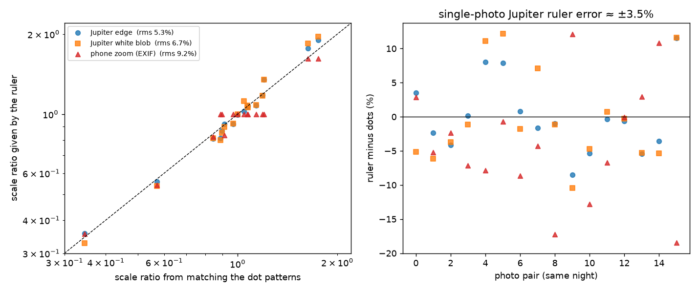
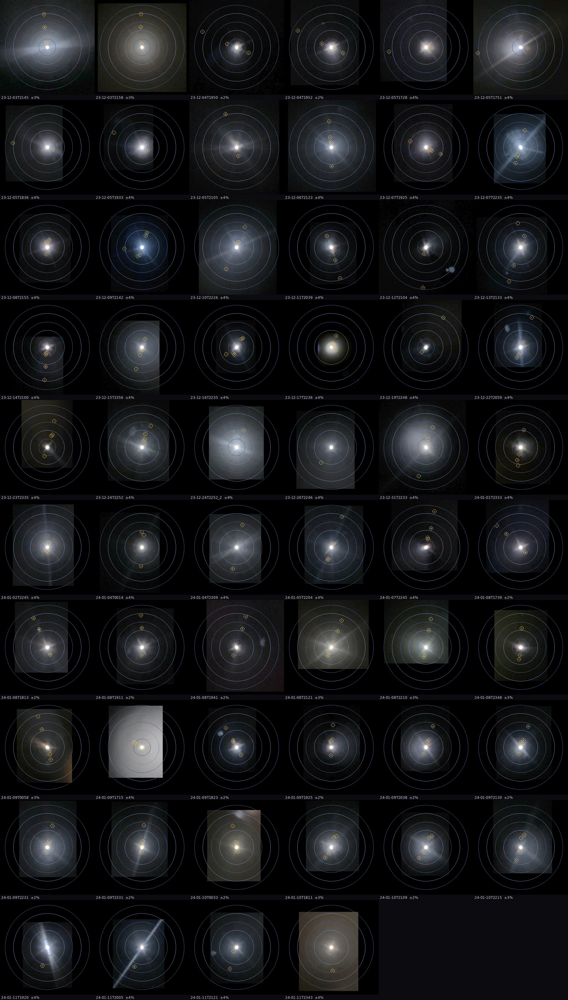

# jupiter-study：假如我是伽利略

[English](README.md) · **中文**

手里只有 58 张手机贴着望远镜目镜拍的木星照片（2023-12-03 至 2024-01-11，加州 Riverside）。
假设我是 1610 年第一个用望远镜看木星的人：没有 NASA 资料，不知道木星旁边的光点是卫星，
也不知道它们会周期性地来回运动。只凭这些照片，一步一步把事情弄清楚。

**能用的信息**：照片本身、照片里相机记录的信息（拍摄时间、变焦），以及拍摄者告诉我的拍摄地点
（`data/observer.json`：北纬 33.976683°，西经 117.310320°，误差半径 30 米）。
**不用的信息**：任何星历、轨道、卫星名字、木星大小或距离。

## 进度

| 步骤 | 内容 | 状态 |
|---|---|---|
| 1 | 统一每张照片的比例 | ✅ 完成 |
| 2 | 统一每张照片的方向（旋转、镜像） | 待做 |
| 3 | … | |

## 第 1 步：统一比例

**问题**：每张照片的放大倍数都不一样，木星在一张照片里半径 20 像素，在另一张里 130 像素，
所以不能直接比较“光点离木星多远”。

**尺子用木星本身**（伽利略也是用木星直径当单位）。所有距离都用“木星半径”（Rj）表示。
木星和光点在同一张照片里，不管放大倍数怎么变，它们都一起变。

**木星有多大**：木星严重过曝，白色亮斑会随曝光变大。所以木星的边缘不取亮斑的边，而是取
“一圈一圈平均亮度下降最快”的位置，也就是被模糊了的真实边缘。

**不靠外部资料检查这把尺子**：同一晚、相隔 90 分钟以内的照片，光点排列几乎不变。
把两张照片的光点图案对齐，就能直接得到两张照片真实的比例关系。16 对照片的对比结果：

| 尺子 | 和光点图案的差异（均方根） |
|---|---|
| 木星边缘（最陡下降处） | **5.3%** |
| 木星白色亮斑 | 6.7% |
| 手机变焦（EXIF） | 9.2% |



**发现**：
- 手机变焦不可靠。1 月 9 日整晚变焦都是 5 倍，实际比例却在相邻照片间变了 0.89–1.20 倍，
  应该是手机位置或对焦变了。12 月 24 日两张相隔 1 秒、变焦相同的照片，比例也差了约 10%。
- 木星边缘作单张照片的尺子，误差约 **±3.5%**。
- 同一晚能用光点连起来的照片（22 张）一起平均，误差降到 1.7–2.5%。

**两种误差分开列**（`output/step1/scale.csv`）：

| 误差来源 | 大小 | 说明 |
|---|---|---|
| 照片误差 `err_photo_pct` | 1.7–3.5% | 木星边缘测量、光点定位、光点在两张照片间的移动 |
| 地点误差 `err_site_pct` | < 1×10⁻⁷ % | 比例是“光点偏移角 ÷ 木星半径角”，两者在同一地点同时看。相机挪 30 米，两个角度几乎同样变化，比值的变化小于 5×10⁻¹⁰ |

地点误差在这一步可以忽略，到判断照片方向的步骤会单独计算。

**还不知道的**：木星过曝后，“最陡下降处”可能比真正的边缘大一个固定比例，这个比例对所有照片都一样。
它不影响照片之间的比较，也不影响以后要找的周期；但不借外部资料，暂时没法确定它是多少。

**全部照片统一比例后**（蓝圈 = 5、10、15、20、25 Rj，黄圈 = 找到的光点，方向还没统一）：



一个初步观察：所有光点都在离木星 25 Rj 以内。

## 目录

```
data/raw/                 58 张原始照片（文件名 = 当地时间）
data/observer.json        拍摄地点
scripts/common.py         读照片、EXIF、解码
scripts/detect.py         找木星和光点
scripts/step1_scale.py    第 1 步
output/step1/             第 1 步结果
  scale.csv               每张照片 1 Rj = 多少像素，两种误差
  pairs.csv               同一晚照片的光点图案匹配
  detections.json         木星和光点的像素位置
  ruler_check.png         三把尺子的对比
  same_scale.jpg          统一比例后的全部照片
```

## 运行

```bash
python3 -m venv .venv
.venv/bin/pip install -r requirements.txt
.venv/bin/python scripts/step1_scale.py      # 约 2–3 分钟
```

第一次运行会把照片解码到 `cache/`（约 650 MB，不进 git）。

旧版本（借助 NASA 星历的分析）保存在 git 历史里（提交 `4d0c22b`）。
