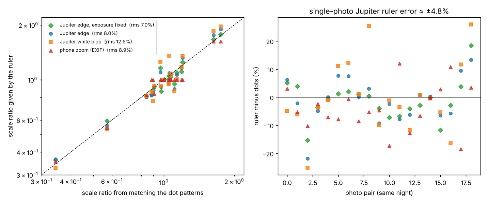
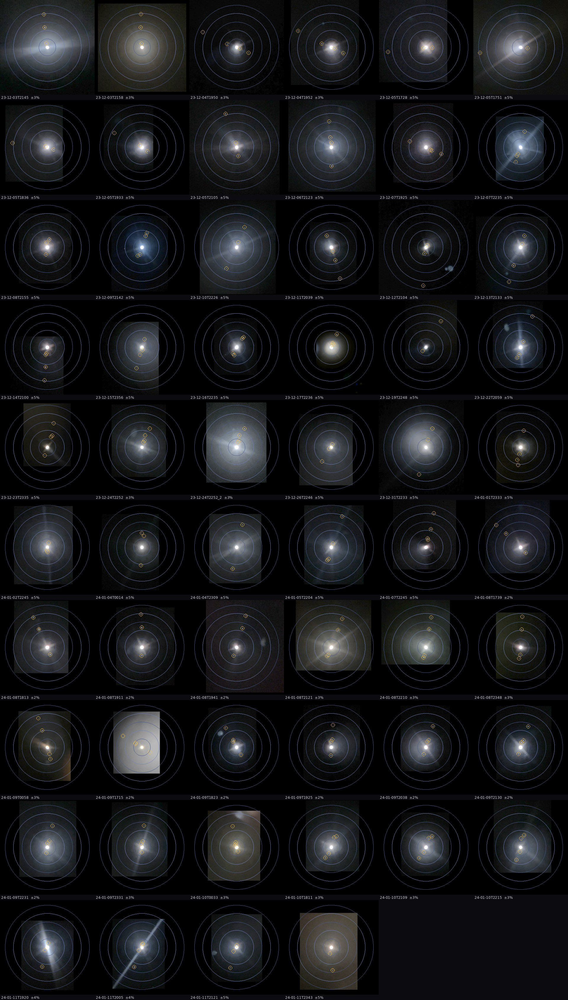
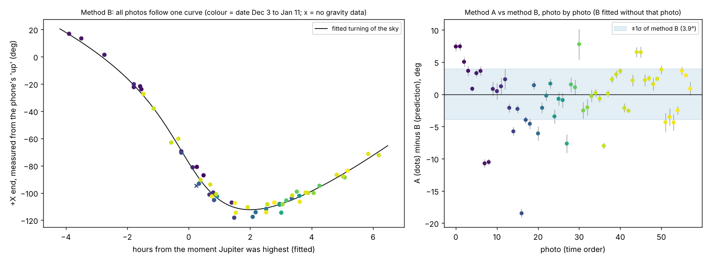
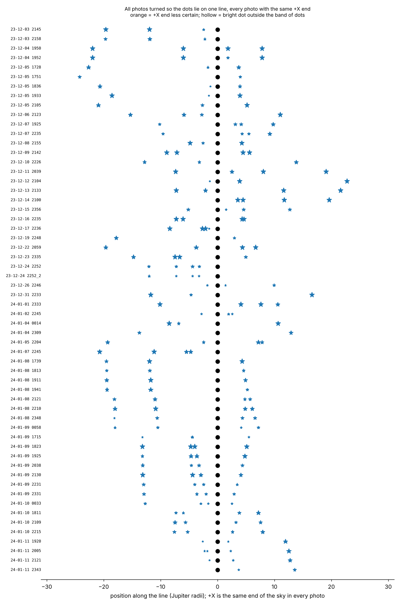
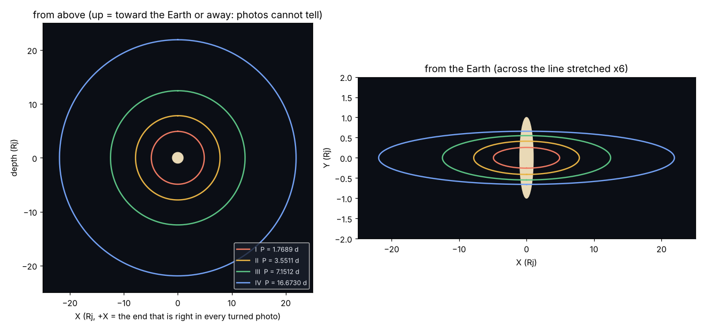
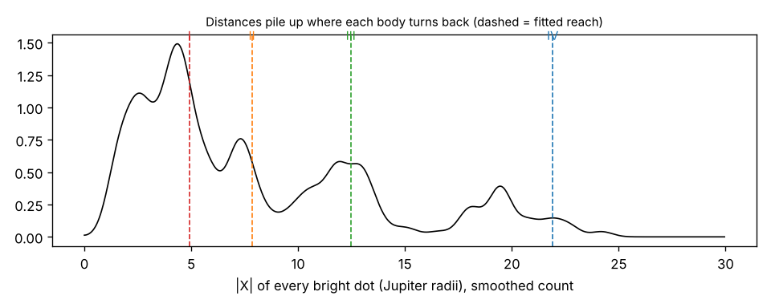
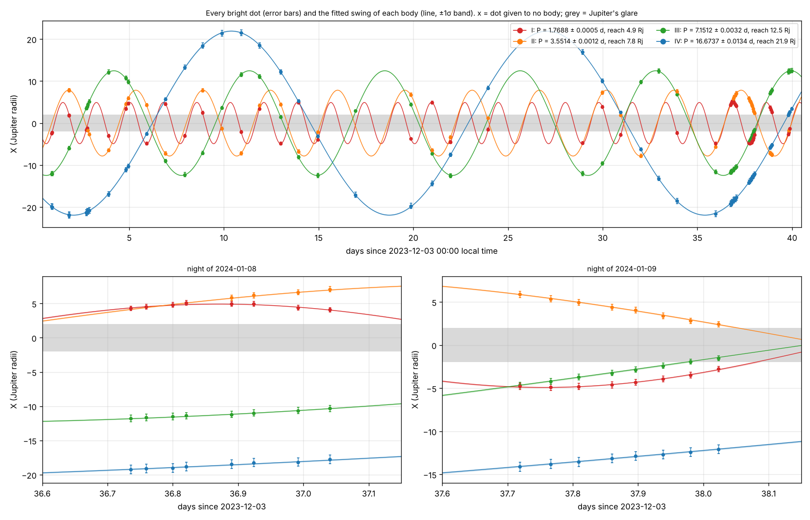
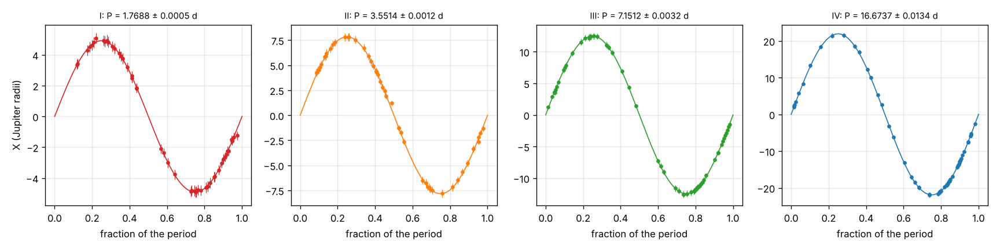

# jupiter-study：假如我是伽利略

[English](README.md) · **中文**

手里只有 58 张手机贴着望远镜目镜拍的木星照片（2023-12-03 至 2024-01-11，加州 Riverside）。
假设我是 1610 年第一个用望远镜看木星的人：没有 NASA 资料，不知道木星旁边的光点是卫星，
也不知道它们会周期性地来回运动。只凭这些照片，一步一步把事情弄清楚。

**能用的信息**：照片本身；照片里相机记录的信息（拍摄时间、变焦、iPhone 重力传感器）；
拍摄者告诉我的拍摄地点（`data/observer.json`：北纬 33.976683°，西经 117.310320°，误差半径 30 米）。
**不用的信息**：任何星历、轨道、卫星名字、木星大小或距离。

每个结果都带**照片误差**（来自像素测量）。拍摄地点不确定 30 米带来的**地点误差**每一步都算过，小到可以忽略（周期上不到照片误差的百万分之一），所以不再列出。

## 进度

步骤按演示页面的顺序；脚本编号是早先定的，和页面不完全一致。

| 页面 | 内容 | 脚本 | 状态 |
|---|---|---|---|
| 第 1 步 | 用木星当尺子：统一每张照片的比例 | `step1_scale.py` | ✅ |
| 第 2 步 | 它们是在绕着木星转吗：环绕的证据 | 页面里计算 | ✅ |
| 第 3 步 | 把每张照片转正：线水平，天上的同一头朝右 | `step2_orient.py`、`field_rotation.py` | ✅ |
| 第 4 步 | 四个天体各绕一圈要多久（从头重做，①–⑧） | `step4_*.py` | ✅ |
| 第 5 步 | 模型：每张照片的比例修正、转正标注的照片、3D 模型 | `step5_model.py` | ✅ |
| 对照 | 早一版的认点和周期 | `step3_motion.py` | 保留 |

**主要结果**（第 5 步，只来自照片）：木星旁边有 4 个天体，沿着几乎侧对着我们的圆绕木星转，四个圈在同一个平面里、转的方向相同。

| 天体 | 周期（天） | 最远距离（Rj） | 倾斜（°） | 光点数 |
|---|---|---|---|---|
| I | 1.76895 ± 0.00020 | 4.91 ± 0.05 | -3.0 ± 0.4 | 49 |
| II | 3.55108 ± 0.00070 | 7.83 ± 0.09 | -3.0 ± 0.2 | 48 |
| III | 7.15117 ± 0.00179 | 12.47 ± 0.12 | -2.5 ± 0.2 | 56 |
| IV | 16.6730 ± 0.0058 | 21.92 ± 0.22 | -1.7 ± 0.2 | 58 |

± 为照片误差；最远距离的单位是第 1 步的“木星半径”（过曝的木星量出来偏大一个没校准的比例）；倾斜是轨道离“正好侧对着我们”差多少度。
周期和最远距离满足 P² ∝ a³（开普勒第三定律），内侧三颗的周期锁在 1 : 2 : 4（第 4 步 ⑧）。

## 光点核对

自动检测程序（`scripts/detect.py`）在 58 张照片里找出了 848 个候选亮点，其中大多是光晕里的波纹、
噪点、地面灯光。每张照片里哪些亮点是木星旁边那些小天体的光点，经过逐张核对确认，
记录在 `data/visual_check.json`（只有像素坐标）：一共 205 个，其中 5 个是程序漏掉、
但照片上看得见的（大多紧贴木星，或是手抖重影旁挤在一起的点），中心位置从照片像素里测出。
后面三步只用这 205 个确认过的光点。

## 第 1 步：统一比例

**问题**：每张照片的放大倍数都不一样，木星在一张照片里半径 20 像素，在另一张里 130 像素。

**尺子用木星本身**（伽利略也是用木星直径当单位）。所有距离都用“木星半径”（Rj）表示。
木星和光点在同一张照片里，不管放大倍数怎么变，它们都一起变。
木星严重过曝，白色亮斑会随曝光变大，所以木星的边缘取“亮度下降最快”的位置：
从木星中心向外打 360 条射线，每条线上找亮度下降最快的点，再用一个圆去贴这 360 个点
（被衍射芒刺或光斑带偏的个别射线权重很小）。贴出的圆心就是木星中心，360 个点离圆的散布给出这张照片的测量误差（中位 ±0.4%）。

**曝光修正**：曝光越强，过曝的白色往外漫得越远，连“下降最快处”也跟着变大。曝光有多强，同一张照片里就看得出来：
卫星光点的总光量（去掉手机存图的伽马、扣掉背景）除以木星在照片里的面积，正比于木星表面每个像素有多亮，
而且手抖把光点拉长也不影响总光量。同一晚成对照片的光点图案给出：这个亮度每大 e 倍（约 2.7 倍），
木星边缘大 **6.3% ± 3.0%**。每张照片的边缘都按这个关系拉回到中位数的曝光。

**不靠外部资料检查这把尺子**：同一晚、相隔 90 分钟以内的照片，光点排列几乎不变，
把两张照片的光点图案对齐，就能直接得到两张照片真实的比例关系。19 对照片的对比：

| 尺子 | 和光点图案的差异（均方根） |
|---|---|
| 木星边缘 + 曝光修正（采用） | **7.0%** |
| 木星边缘（360 条射线贴圆） | 8.0% |
| 手机变焦（EXIF） | 8.9% |
| 木星白色亮斑 | 12.5% |

（旧版的边缘取“一圈一圈平均亮度下降最快处”，同样的检验是 9.0%。）



**发现**：
- 手机变焦不可靠：1 月 9 日整晚变焦都是 5 倍，实际比例却在相邻照片间变了约 ±10%。
- 木星边缘加曝光修正作单张照片的尺子，误差约 ±4.8%（旧版 ±6.2%）；同一晚能用光点连起来的 27 张照片一起平均，误差降到 2.1–3.7%。
- 第 5 步用“同一个天体每次都摆到同样远”反过来测得单张照片比例的实际偏差，典型是 ±4.5%，和这里的估计一致。
  其中 12 月 17 日那张（唯一一张 iPhone 14 Pro 拍的）偏得最多：光晕更大，木星量大了约 49%，第 5 步把它修正了回来（× 0.672）。
  12 月 26 日那张曝光最短，过曝最轻，木星看起来最小。
- 试过但没有采用：按手抖方向只量垂直于抖动的两侧（和光点图案对得更差）；在全分辨率下重新量光点中心（没有改进）。
- 和旧版相比，统一后的“1 Rj”在像素里大了约 3%（射线法找到的边缘略靠外），所以所有以 Rj 表示的距离小了约 3%。
  这是单位的约定，不影响周期。
- 地点误差：比例是“光点偏移角 ÷ 木星半径角”，两者在同一地点同时看，相机挪 30 米，比值的变化小于 5×10⁻¹⁰。

**还不知道的**：曝光修正把每张照片拉回到同一个曝光，但在这个曝光下，“最陡下降处”仍可能比真正的边缘大一个固定比例。
这个比例对所有照片都一样，不影响照片之间的比较和周期，但不借外部资料没法确定。



## 第 2 步：环绕的证据（页面里计算）

转正、统一比例以后，光点是什么？是远处的星，还是在一条线上来回晃？三条只用照片、不需要知道周期的证据：
① 40 天里它们一直跟着木星（木星自己在星空里移动了约 3°，比望远镜视野大得多）；
② 光点在线上的分布左右对称地在最远点附近堆积，两边摆得一样远；
③ 去和回走在线的两侧（只用同一晚的照片，是初步的；完整的检验在第 4 步 ⑦）。

## 第 3 步：统一方向（`step2_orient.py`）

**问题**：每张照片手机转的角度不一样，而且一晚上天空本身也在转（木星升起又落下，
天空相对地平线转动），所以光点连成的线在每张照片里指向不同的方向。线还有两头，要分清哪头对哪头。

**伽利略的第一个发现：光点总在一条直线上。**用三种独立的方法确定这条线，互相比对：

| 方法 | 怎么做 | 优点 | 局限 |
|---|---|---|---|
| A 光点连线 | 每张照片单独找穿过木星、离光点最近的直线 | 角度准（中位 ±0.8°） | 分不出线的两头 |
| B 重力 + 天空旋转 | iPhone 记录了每张照片“哪边朝下”；从这个方向量，线一晚上的转动规律每晚都一样，拟合一条曲线就能预测每张照片里线的方向，**包括哪头对哪头** | 所有照片统一到同一头 | 单张 ±3.9° |
| C 同一晚配对 | 同一晚 3 小时内的照片用光点图案配对，看两头怎么对应 | 直接、可靠 | 只用来检验 B |



**B 的发现**：手机几乎一直竖直（侧倾不超过约 10°），线却一晚上转了 100° 以上，
而且 12 月和 1 月所有晚上都落在同一条曲线上。拟合这条曲线，只靠照片就推出了：

- 木星 12 月 3 日 **21:20 ± 2 分钟**升到最高，赤纬 **+13.8° ± 0.7°**，此后每天比恒星再早 0.56 ± 0.11 分钟（木星在恒星间的移动）
- 曲线转动的方向说明像**没有镜像**；外加随高度的转动项，像目镜朝侧面的反射式望远镜
- 1 月 10 日那张照片文件名写 18:11，相机记录 20:11。按相机时间，预测和实测差 4°；按文件名差 55°。**相机时间是对的**

**比对结果**：A 和 B 的差异均方根 4.8°，没有一张超过 3 倍误差；C 检验 B：**36/36** 对一致；
每张照片的 +X 端都至少有 4 倍误差的余量；重力传感器的坐标方向也验证了（方向弄反拟合明显变差）。

**最终方向**：A 的光点和 B 的预测一起求最可能的角度。离木星远的光点定方向比近的准得多，按距离加权。
B 决定哪头是 +X。中位误差 ±0.8°。

**光点是一条带，不是一条线**：转正后所有确认的光点都在离线 ±2.3 Rj 以内，均方根 0.42 Rj，
而且越外面的天体离线越远（第 4 步 ⑦）：轨道不是正好侧对着我们。

**+X 是哪头**：+X 在所有照片里都是天上的同一头。它是东还是西，取决于望远镜成的像是正的还是倒的，照片本身看不出来。

| 误差来源 | 大小 | 说明 |
|---|---|---|
| 照片误差 `err_photo_deg` | 中位 ±0.8° | A 和 B 合并后的角度误差 |
| 地点误差 `err_site_deg` | 最大 5×10⁻⁶ ° | B 用到观测地纬度；把纬度挪 30 米重新拟合：预测角度最多变 0.0002°，赤纬变 0.0004°，过中天时间变 0.0001 分钟 |



## 第 4 步：周期（从头重做，`step4_*.py`）

不预先假定有几颗、不画曲线，从原始的“时间、位置”开始：

| 部分 | 内容 | 脚本 |
|---|---|---|
| ① | 205 个光点，只有拍摄时间和沿线位置 X | `step4_raw_plot.py` |
| ② | 一晚多张照片：把前后照片里的光点连成轨迹（沿线外推、离线距离 Y 基本不变） | `step4_tracks.py` |
| ③ | 最外面那颗：16 Rj 以外只有一颗，折叠找周期（光点 + 一晚速度 + “该在却不在”） | `step4_fold.py` |
| ④ | 拿走已解释的光点，找下一道空隙再折叠；内侧两颗重叠，一起找 | `step4_peel.py`、`step4_inner.py` |
| ⑤–⑧ | 四颗一起归属光点；“每天多转一圈”的对手；扁圆检验；周期之间的规律 | `step4_joint.py` |

结果（照片误差；这一步还没有每张照片的比例修正）：

| 天体 | 周期（天） | 最远距离（Rj） | 离线摆动 B（Rj） |
|---|---|---|---|
| I | 1.7686 ± 0.0008 | 4.81 ± 0.08 | -0.25 ± 0.04 |
| II | 3.5521 ± 0.0020 | 7.78 ± 0.13 | -0.32 ± 0.05 |
| III | 7.1526 ± 0.0059 | 12.52 ± 0.20 | -0.57 ± 0.06 |
| IV | 16.6945 ± 0.0242 | 22.10 ± 0.35 | -0.60 ± 0.08 |

- ④ 找空隙时只算外面光点够折叠（≥ 8 个）的空隙。内侧两颗：单独折叠时分数最好的反而是错的周期，两颗一起找、
  再要求“不在没有光点的地方预测一颗”，才分出 3.53 + 1.77 天这一组。
- ⑥ “每天多转一圈”的对手周期，偏差分数至少差 35 倍；去掉一晚多张的夜晚仍至少差 9 倍。
- ⑦ 四颗的离线摆动 B 都是负的（6–10 倍误差）：它们是几乎侧着看到的圆，在同一个平面、朝同一个方向转。
- ⑧ log P 对 log a 的斜率 **1.47 ± 0.02**（开普勒第三定律是 1.5）；P₂/P₁ = 2.0084，P₃/P₂ = 2.0136；
  1/P₁ − 3/P₂ + 2/P₃ = (0.45 ± 0.59)×10⁻³ 圈/天，和 0 一致。

## 第 5 步：模型（`step5_model.py`）

把第 4 步的四条摆动和每张照片自己的比例一起拟合：一颗天体每次都摆到同样远，所以一张照片里只要有两颗以上，就能定出这张照片的比例。
认点也重做了一遍：每张照片先在 0.6–1.6 倍之间试遍放大倍数，再把光点一一对应地分给四颗（每颗最多一个光点，两颗预测挤在一起时才共用）。

- 58 张照片都定出了自己的比例，典型修正 ±4.5%；最大的是 12 月 17 日那张（× 0.672）。
- 205 个光点全部有归属，光点离模型的偏差中位 **0.067 Rj**（第 4 步 ⑤ 是 0.30 Rj）；周期误差平均小了约 3.6 倍。
- 倾斜（离线摆动 ÷ 最远距离）：-3.0°、-3.0°、-2.5°、-1.7°，四颗都是负的。
- 输出：每张照片转正、统一比例的条带图（`demo/final/`，页面在上面画标注），所有照片的标注总览 `output/step5/annotated.jpg`，模型图 `output/step5/model.png`。



页面上的第 5 步有时间滑块（可以播放）、离当前时刻最近的那张照片（转正、统一比例、标注、模型预测），和一个只用照片搭出的 3D 模型
（从地球看 / 俯视 / 侧视 / 斜视，照片里每个光点的视线）。照片定不出：轨道哪半圈在木星前面（模型可以“前后对调”，从地球看完全一样）、
+X 是东还是西、真实大小和质量、卫星和木星的样子。

## 对照：早一版的认点和周期（`step3_motion.py`）

这是第 4 步重做之前的做法，保留作对照；页面第 1 步的尺子检验和第 2 步的图仍用它的比例修正和归属。结果和第 5 步在误差内一致。

**数天体**：来回摆动的东西在最远点附近停留得最久，所以光点离木星的距离在几个地方堆积。
堆积在 4.4、7.3、12.0、19.5 Rj 附近：**4 个天体**。



**从外往内逐个找**：只有最外面的天体能到达最外面的堆积，所以先找它。试遍 0.5 到 50 天的所有周期、
起点和最远距离，逐张照片打分：预测的位置上有光点 +1，预测在照片视野里、木星光晕外却没有光点 −1。
“该有却没有”也是证据。找到后把它的光点拿走，再找下一个。最佳周期的得分要明显高于随便挑一个周期
能得到的分数（所有周期得分的 99% 分位 + 3）才算找到。

**四个一起精修**：每个光点交给预测离它最近的天体，再一起拟合每个天体的摆动
X = A sin(2π t / P + φ)，同时给每张照片拟合一个比例修正（先在 0.5–1.6 倍之间试遍，找到让光点和预测最吻合的比例）。
205 个光点**全部**归给了某个天体，拟合残差中位 0.05 Rj。





**检查**：
- **混叠**：大部分照片都在晚上差不多同一时间拍，周期 P 和“每天多转或少转一圈”的周期看起来很像。
  每个天体都列出了最接近的对手周期（`bodies.json`），例如 I 的 1.769 天得分 46，对手 2.301 天只有 24；
  1 月 8、9 日一晚多张照片把它们分开。
- **是圆不是直线**：光点在摆动的同时，离线的距离也按 cos 变化（I −0.25 ± 0.04，II −0.39 ± 0.03，
  III −0.55 ± 0.05，IV −0.64 ± 0.07 Rj），幅度和最远距离成比例：它们沿着从侧面略斜着看到的圆在转，
  而且四个转的方向相同。

**误差**：
- 照片误差：拟合协方差（按实际残差缩放）和按夜重抽样（200 次，每次随机抽 31 个晚上重新拟合）中较大的一个。
- 地点误差：转正那一步的地点误差让每张照片转一个极小的角度，光点 X 因此变化 Y × 角度。
  这个变化远小于拟合的数值精度，所以放大一万倍去拟合，再按比例缩回来。

## 演示页面

`demo/` 是一个交互网页，按上面的 5 步展开：每张照片的原图和标注、尺子的对比、环绕的证据、天空旋转曲线、
第 4 步的 ①–⑧，以及第 5 步的时间滑块、转正标注的照片和 3D 模型。本地查看：

```bash
python3 -m http.server -d demo 8000
```

然后打开 http://localhost:8000/view.html 。3D 模型从 jsdelivr 加载 three.js，需要联网；其他部分不需要。
`demo/data.json` 由 `scripts/make_demo.py` 生成，`demo/step4_data.json` 由第 4 步的脚本生成，`demo/model_data.json` 和 `demo/final/` 由 `scripts/step5_model.py` 生成。
`python3 tools/bundle_preview.py demo 输出.html` 把页面、数据和图片打包成一个可以直接双击打开的文件。

## 目录

```
data/raw/                 58 张原始照片（文件名 = 当地时间）
data/observer.json        拍摄地点
data/visual_check.json    逐张核对确认的光点（像素坐标）
scripts/common.py         读照片、EXIF、重力传感器、解码
scripts/detect.py         找木星（360 条射线贴圆）、候选光点、光点亮度
scripts/step1_scale.py    第 1 步：统一比例（含曝光修正）
scripts/step2_orient.py   第 3 步：统一方向
scripts/field_rotation.py 第 3 步方法 B：天空旋转模型
scripts/step3_motion.py   对照：早一版的认点和周期
scripts/step4_*.py        第 4 步 ①–⑧：raw_plot、tracks、fold、peel、inner、joint
scripts/step5_model.py    第 5 步：最终拟合、转正标注的照片、模型图
scripts/make_demo.py      演示页面的数据和图片
output/step1/ … step5/    每一步的结果（csv、json、图）
demo/                     演示页面（index.html 用于 claude.ai，view.html 用于本地）
tests/                    Python 测试；tests/page/ 是页面脚本的测试（Node）
tools/bundle_preview.py   把页面打包成单个文件
```

## 运行

```bash
python3 -m venv .venv
.venv/bin/pip install -r requirements.txt
for s in step1_scale step2_orient step3_motion step4_raw_plot step4_tracks step4_fold step4_peel step4_inner step4_joint step5_model make_demo; do .venv/bin/python scripts/$s.py; done
```

全部约 10 分钟（云端机器；树莓派 5 上更久）。第一次运行会把照片解码到 `cache/`（约 650 MB，不进 git）。测试：

```bash
.venv/bin/python -m pytest -q tests
for t in run click tracks fold step4 joint model; do node tests/page/$t.js demo; done
```

旧版本（借助 NASA 星历的分析）保存在 git 历史里（提交 `4d0c22b`）。
